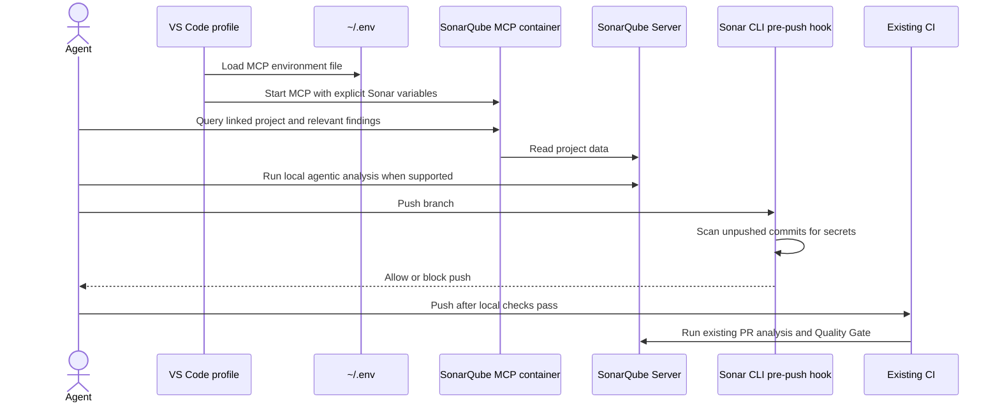

# 0001. Corporate SonarQube MCP and early PR checks

Status: proposed

## Context

The corporate SonarQube MCP configuration is currently edited in VS Code's user profile and contains credentials. SonarQube CI checks already run for pull requests, but findings discovered there waste CI cycles. The corporate profile should keep its MCP configuration reproducible without storing credentials in the Nix store, and agents should run useful checks before pushing.

## Decision

- Manage the corporate VS Code user-profile `mcp.json` and a SonarQube-specific user instruction through Home Manager.
- Load `SONARQUBE_TOKEN` and `SONARQUBE_URL` from `~/.env`; keep the file owner-readable only and keep values out of the repository and Nix store.
- Use the MCP for project and issue context, and run `sonar analyze agentic` on local changes when supported.
- Install the global Sonar CLI pre-push hook with `sonar integrate git --hook pre-push --non-interactive` to scan unpushed commits for secrets. Keep the existing CI Quality Gate as the authoritative quality check.

## Alternatives

- Keep editing the VS Code MCP file manually and replace literal credentials with `envFile`. This avoids a Home Manager takeover but allows configuration drift.
- Rely only on agent instructions. This is easy to bypass and cannot block a push.
- Rely only on CI. This remains authoritative but discovers issues after spending CI time.

## Consequences

- Nix stores only the MCP command, the `~/.env` path, and the Sonar variable names; credential values remain local.
- Home Manager owns the complete VS Code MCP file. Changes to its server definition must be made in this repository rather than through the VS Code editor.
- The MCP config loads `~/.env` for the local Docker client and explicitly forwards only Sonar variables to the container.
- The pre-push hook is a local secret scan, not a code-quality gate, and can be bypassed. Agent instructions are advisory; CI remains the enforcement point for the Quality Gate.
- Local agentic analysis depends on project linking and server support; unavailable checks must be reported rather than treated as passing.
