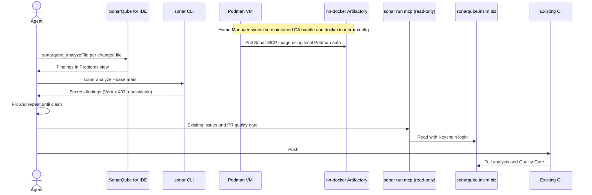

# 0001. Corporate SonarQube MCP and early PR checks

Status: proposed

## Context

SonarQube already runs in CI for corporate pull requests, but findings discovered there cost a CI cycle. Agents should catch issues locally before pushing. The VS Code SonarQube MCP configuration held a literal token in the user profile.

Tested against sonarqube.insim.biz (Enterprise 2026.5.2):

- `sonar analyze` runs the secrets scan; Sonar Vortex code analysis returns 403 (no Vortex subscription), so the CLI cannot preview code issues.
- The SonarQube for IDE extension (already connected to the server) exposes `sonarqube_analyzeFile`, which analyzes a file locally and reports findings in the Problems view.
- `sonar integrate copilot` registers `sonar run mcp` in `~/.copilot/mcp-config.json`, authenticated through the CLI's Keychain login.
- The global Sonar pre-push hook sets `core.hooksPath` globally; Husky repositories set a local `core.hooksPath`, so the hook does not run in them.
- Docker Hub is blocked by corporate network policy. `nn-docker.artifactory.insim.biz` is the documented corporate Docker registry; its unauthenticated `/v2/` endpoint returns 401.
- The SonarQube MCP image pulls successfully through the `docker.io` registry rewrite to Artifactory. The read-only MCP starts, exposes project/issue/quality-gate tools, and a project search succeeds against the corporate server.

## Decision

- Code issues: agents run `sonarqube_analyzeFile` on changed files before pushing.
- Secrets: agents run `sonar analyze --base <base-branch>`; the global pre-push hook covers repositories without a local `core.hooksPath`.
- Server context: the VS Code profile `mcp.json` is Home Manager-managed and runs `sonar run mcp --read-only`, reusing the CLI's Keychain login. No token is stored in a file.
- On Home Manager activation, sync the complete macOS CA bundle into the Podman machine's trust anchors and configure `docker.io` to resolve only through `nn-docker.artifactory.insim.biz`.
- Artifactory credentials remain outside Nix and are installed with `podman login nn-docker.artifactory.insim.biz`.
- A corporate-only Copilot instruction in `~/.copilot/instructions/` defines this workflow.
- CI's SonarQube analysis and Quality Gate remain authoritative.

## Alternatives

- Load the MCP token from `~/.env` through VS Code's `envFile` with the Docker image. Works for the VS Code Local harness, but keeps a long-lived token in a file and duplicates the CLI login.
- Rely on `sonar analyze` alone. Without Vortex it only scans for secrets.
- Rely on CI alone. Authoritative, but finds issues only after a CI run.

## Consequences

- One credential: the CLI's Keychain login serves the CLI and both MCP registrations. Nix stores no secret.
- Home Manager owns the VS Code profile `mcp.json`; servers added through the VS Code UI are overwritten on switch.
- `~/.copilot/mcp-config.json` stays owned by `sonar integrate copilot` and is not read-only; the instruction forbids changing issues or remediating without approval.
- The MCP server needs a running container runtime. The podman machine must be started, and it must trust the corporate TLS-inspection CA to pull `sonarsource/sonarqube-mcp`; until then, step 4 of the instruction is skipped.
- SonarQube for IDE uses the server's quality profile only for workspaces bound in Connected Mode; unbound workspaces use default rules.
- The global `core.hooksPath` makes Git ignore other `.git/hooks/` scripts; Sonar chains only a same-named local hook. No local corporate repository had such scripts when this was written.
- Podman trusts the full host bundle, not an extracted individual root, and redirects Docker Hub image references to the documented Artifactory registry. Artifactory authentication is deliberately not stored in Nix.
- The Artifactory registry endpoint returned 401 to an unauthenticated probe, but the configured SonarQube MCP image pull succeeded without an interactive login.
- The maintained host CA bundle is synchronized to the Podman machine during Home Manager activation. If no Podman machine exists, activation reports that synchronization was skipped.
- Agent instructions are advisory; CI remains the enforcement point.
