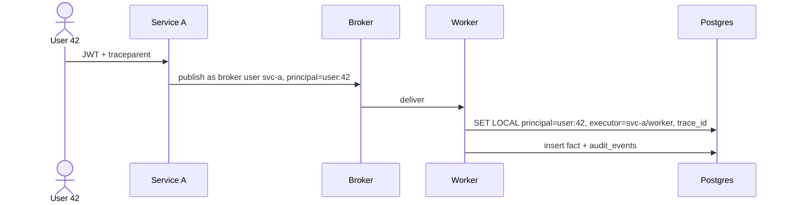

# Actors

For any irregular effect, answer from durable records: who it was for, which component did it, and in which request.

## Two actors per effect

Like git's author and committer:

- **Principal:** on whose behalf, namespaced by kind (`user:`, `service:<name>`, `job:<name>`, `agent:<name>`).
- **Executor:** the authenticated component that performed it.

There is no "system" actor. Jobs, migrations, operators, CI, and AI agents each have their own identity. An agent is the executor and the human who instructed it is the principal; agents never use a human's credentials.

## Identity

- One identity provider for humans. One credential per component per environment for each infrastructure capability (database role, broker user, storage key); never shared [Pragmatic: Stay Safe Out There].
- Verify at every hop; network location grants nothing [NIST SP 800-207].
- Service to service: propagate the user's JWT and also present a projected Kubernetes ServiceAccount token, so the receiver records the authenticated executor. Token exchange with an `act` chain [RFC 8693] or mesh mTLS only for a stated need.
- A principal on a message is the publisher's assertion. Restrict who may publish, and record the authenticated publisher beside it.

## Recording

- Every fact, version, and audit row: principal, executor, trace id, time, plus the request or idempotency key when present. `audit_events` also records source IP, user agent, and outcome [NIST SP 800-53 AU-3; Kubernetes audit log].
- Into the database: the data-access layer sets principal, executor, and trace id as per-transaction session settings that column defaults and audit triggers read (in Postgres: `SET LOCAL app.principal` and so on, the PostgREST and Supabase pattern).
- Order audit records by commit order or a sequence, not wall-clock time alone [DDIA: The Trouble with Distributed Systems].
- Logs: structured, with principal, executor, and trace id [W3C Trace Context]. Log the token subject, never the token or a secret [OWASP Logging Cheat Sheet]. Logs rotate; durable records answer disputes.
- Infrastructure changes go through a reviewed, declarative pipeline (for example GitOps), so the commit is the record. A direct change is break-glass only: the path is documented in advance and each use is recorded as an incident.

