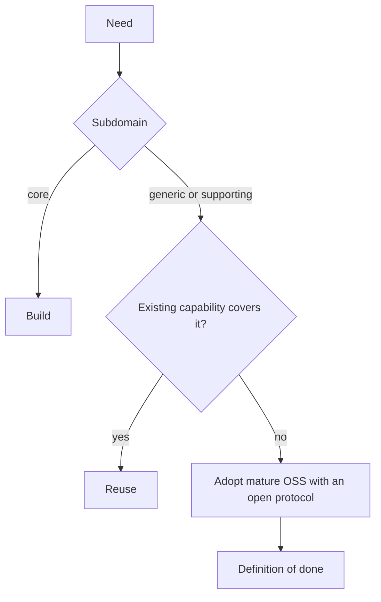

# Capabilities and dependencies

A capability is anything the platform runs on behalf of applications: a database, broker, identity provider, operator, gateway, cache, scheduler, or observability backend. The scarcest resource is operator attention [Brooks: The Design of Design].

## Build or adopt

Classify the need [Evans: Distillation]:
- **core** (the differentiator): build it, and spend innovation there;
- **generic** (identity, messaging, storage, email): adopt;
- **supporting:** the simpler of a small build or an adoption.

The cheapest code is code not written [Brooks: No Silver Bullet].

## A new capability

- Show that a running capability cannot cover the need, even less elegantly: Postgres as a queue, a cache, search, or cron; the existing broker; the existing identity provider.
- At most one new-to-us technology in flight at a time [McKinley: Choose Boring Technology].
- Adoption criteria:
  - mature and maintained: years in production, active releases, more than one maintainer, CVE response (OpenSSF Scorecard as a signal);
  - operability fit: declarative install via GitOps, a metrics endpoint, a backup and restore story, runs without HA;
  - an open protocol and exit path (SQL, OIDC, S3, OTel, CloudEvents) [Pragmatic: Reversibility].
- Prefer an operator already in use; use plain manifests when there is one instance and no lifecycle to automate.

## Definition of done

- an owner and one GitOps declaration;
- credentials scoped per consumer and environment;
- a symptom alert with a runbook;
- for state: backups and a performed restore;
- an upgrade path and an exit path;
- a decision record (see records).

## Upgrades

Automated upgrade PRs (Renovate) promoted through environments like any change. Where one deployment serves every environment (shared infrastructure), record how upgrades are staged instead. Small, frequent steps; nothing pinned without a recorded reason.

## Alternatives

| Reaching for | Often sufficient | Add it when |
| --- | --- | --- |
| Cache server | Index, HTTP caching, in-process memo | Measured load or latency the database cannot meet |
| Search engine | Postgres full-text search, pg_trgm | Relevance or scale the database lacks |
| Workflow engine | Idempotent consumer chain, state in the owner's tables | Multi-step compensation must be tracked |
| Service mesh | NetworkPolicy plus workload tokens | mTLS identity or traffic policy is required |
| HA replicas | Single instance plus drilled restore | Restore cannot meet a stated target |
