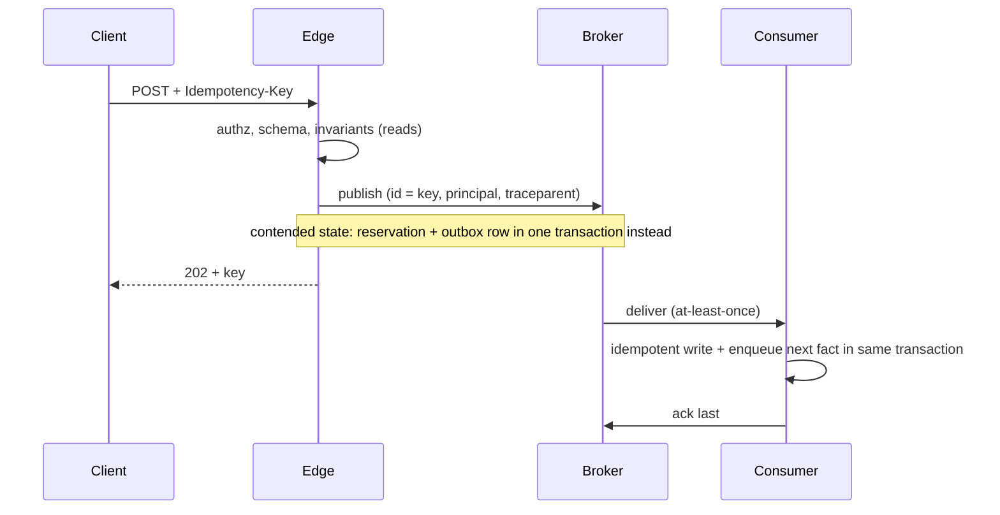

# Communication

Every remote call can fail, time out, or succeed without a reply [Deutsch: Fallacies of Distributed Computing].

## Sync or async

Decide per operation, in order:

1. **No one besides the caller reacts:** plain synchronous write, no event. Events exist only where a consumer does.
2. **Completion gates something you do not mediate** (authentication, authorization, a third party acting on the result), **or rejection must be immediate:** synchronous.
3. **Otherwise, when another component must react or the work is slow or external:** validate synchronously (authorization, schema, invariants), publish, return 202 with the idempotency key. When acceptance depends on contended state (uniqueness, stock, quota), either commit the reservation and the outgoing message in one transaction (job table as outbox) before the 202, or move the check into the consumer and expose rejection as status.

Async adds a pending state to every read path and needs a visible status for dead-lettered work [Ousterhout: The Nature of Complexity]. Do not go async to make a handler feel faster.

## Reacting to state owned elsewhere

- **Business facts** (payment received, order placed): events, past tense, owned by the emitter [Evans: Domain Events; Hohpe: Event Message].
- **Desired state** (make X look like Y): level-triggered reconcile loops that converge and resync, so a missed event self-heals [Kubernetes].
- A **command** asks one owner to act; do not disguise a command as an event to hide the dependency [Hohpe: Command Message].

## Delivery

- At-least-once delivery, idempotent consumers keyed on a stable id; "exactly-once" means effectively-once [DDIA: Stream Processing; Hohpe: Idempotent Receiver; Stripe: Idempotency Keys].
- **Background work inside a component:** a job table in its own database, written in the same transaction as the change (River, Oban, Solid Queue). The same table serves as its outbox when the component must also publish.
- **Messages between components:** the broker. An HTTP handler that both commits and publishes is a dual write; publish only and let the consumer write. A consumer that short-circuits redeliveries as "already processed" loses its outgoing event; enqueue the publish in its transaction instead.
- Bounded retries with backoff to a dead-letter path that alerts and can replay [Hohpe: Dead Letter Channel]. Large payloads by reference [Hohpe: Claim Check].

## Contracts

One envelope standard (CloudEvents) and one schema format for the system. Version the contract by major version only; consumers are tolerant readers [DDIA: Encoding and Evolution]. Every message carries id, type and version, source, principal, trace context, and time [Hohpe: Correlation Identifier].

## Workflows

Default: a chain of idempotent consumers, each publishing the next fact, with progress visible in the owner's tables. Move to durable execution (Temporal, Restate) only when compensation across many steps must be tracked.

## Reads across components

Read synchronously from the owner. Materialize a local projection only when the call is too slow or frequent, crosses an availability boundary, or many components need it; it must be rebuildable. Never write to another component's store.

## Avoid

Two-phase commit across services; claims of exactly-once delivery; choreographing everything through events; an event per write with no consumer.
