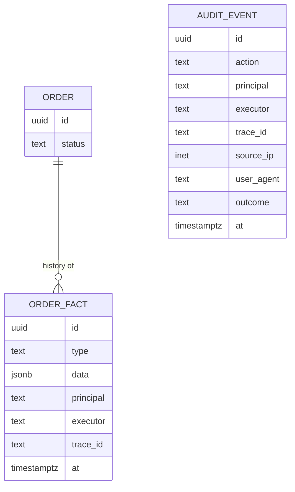

# Data

The data design is the architecture: show the tables and the flowcharts become obvious [Brooks: Ten Pounds in a Five-Pound Sack; Bentley: Data Structures Programs].

## Ownership and consistency

- One owner and system of record per table; everything else is derived and rebuildable [DDIA: The Future of Data Systems].
- In a modular monolith each module owns a Postgres schema; other modules use its code API, never its tables. Check this in CI.
- One aggregate per transaction; across aggregates, consistency is eventual [Evans: Aggregates]. Know the isolation level: invariants spanning rows need serializable isolation or an explicit lock [DDIA: Transactions].
- Migrations are expand/contract so old and new code run against the same schema.

## History, versions, audit: three different things

| Kind | Answers | Default |
| --- | --- | --- |
| Domain facts | What happened in the business? | Append-only rows where the business has history; these are the audit record [Helland: Immutability Changes Everything]. Values that change over time get `valid_from`/`valid_to`. |
| Row versions | What did this mutable row look like before? | Only for a table with a stated need (PaperTrail-style versions table). No blanket history. |
| Audit events | Who did what security-relevant thing? | Append-only `audit_events` per component, same transaction, for authentication, permission, admin, export, and delete actions (GitLab, Keycloak, Kubernetes audit log). Not needed where an existing durable audit log already records those actions, such as an identity provider's event log or the Kubernetes API audit log. |

- Enforce immutability in the database (revoke UPDATE/DELETE from the app role, or a rejecting trigger) when the record must be trustworthy.
- Every fact, version, and audit row carries actor fields (see actors).

## Deletes

- Hard delete by default. When restore or retention is required, copy the row as JSON into a `deleted_records` table in the same transaction [brandur: Soft Deletion Probably Isn't Worth It].
- Where retention and erasure both apply, keep the fact and erase or pseudonymize its personal data [DDIA: The Future of Data Systems].

## Avoid

A shared integration database; business logic in stored procedures; `deleted_at` on every table; event sourcing by default; generic history on every table.
