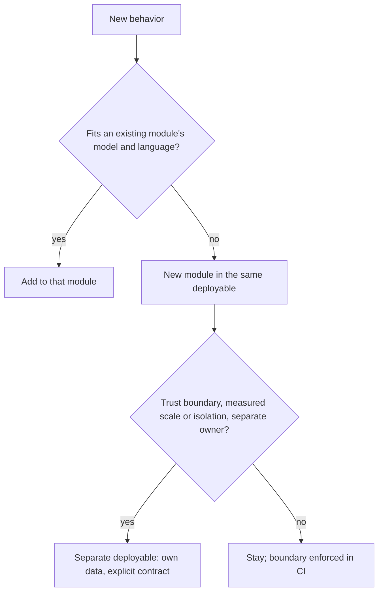

# Decomposition

## Defaults

- Split along decisions likely to change, not along processing steps [Parnas: On the Criteria]. Each part is deep: a small interface over substantial hidden behavior. A shallow service is a shallow module plus a network [Ousterhout: Modules Should Be Deep].
- **Modular monolith first:** one deployable per product, bounded contexts as modules [Evans: Bounded Context; Fowler: MonolithFirst].
- **Enforce module boundaries with tools:** language visibility plus a CI import check (Go `internal/`, depguard, import-linter, dependency-cruiser) [Ford: Fitness Functions]. Each module owns its database schema (see [data](data.md)).
- **Split into a separate deployable only for a present force:**
  - trust boundary: public edge vs internal, processing untrusted input, different credentials;
  - measured scaling need or required failure isolation;
  - a separate owning team with its own cadence [Conway; Skelton: Team Topologies] - rare with one owner, common in multi-team organizations.
  A different runtime (language, vendor binary) is a valid but rare fourth.
- A split gets its own data, an explicit contract, and the operability baseline. Extract incrementally behind the existing interface, not by rewrite [Fowler: Strangler Fig; Newman: Monolith to Microservices].
- Infrastructure that converges actual state to desired state uses a reconciler: a declarative resource plus a controller [Kubernetes].

## Shapes in practice

| Shape | Fits when | Examples |
| --- | --- | --- |
| Monolith plus workers | One product, one owner | Discourse, Mastodon |
| Modular monolith, few extractions | Extractions forced by performance or isolation | GitLab (Gitaly), Sentry (Relay) |
| Single binary, multiple roles | Scale-out is foreseeable; run as one process until then | Grafana Loki/Mimir/Tempo `-target` |
| Control plane plus reconcilers | Infrastructure with desired state | Kubernetes (about 40 controllers in one controller-manager binary), Argo CD, cert-manager |

## Avoid

A service per entity or table; services sharing tables (a distributed monolith); splitting to be ready to scale; central orchestration buses.
