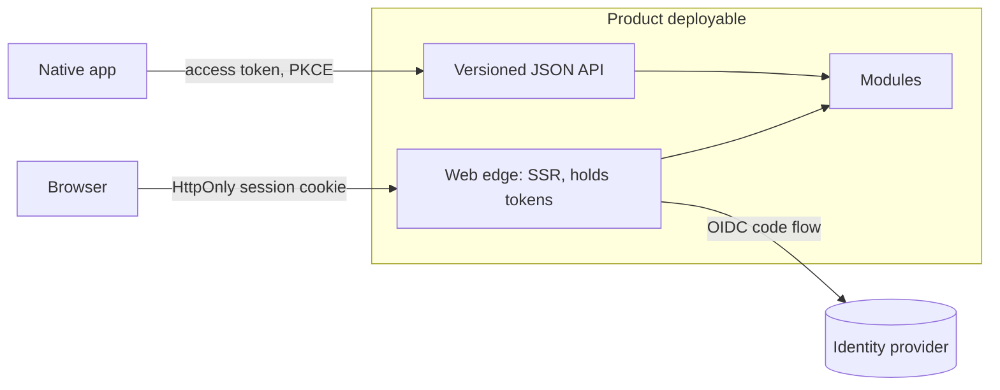

# Frontend and clients

## Defaults

- **Server-render first.** Pages are rendered by the product's own deployable. Client-side interactivity is scoped to the components that need it (islands or progressive enhancement) [Ousterhout: Pull Complexity Downwards; Miller: Islands Architecture]. A JSON API exists where a non-browser client needs one, not for every screen.
- **The web edge is the BFF.** The product's web server runs the OIDC code flow with PKCE, keeps tokens server-side, and gives the browser an `HttpOnly`, `Secure`, `SameSite` session cookie. No tokens in browser storage [IETF: OAuth 2.0 for Browser-Based Applications].
- **Native apps** are public OAuth clients: code flow with PKCE, tokens in the OS keychain [RFC 8252]. They call the same deployable's versioned JSON API.
- **Clients never call internal deployables directly.** That makes the internal layout the public contract and moves orchestration onto slow networks. With a modular monolith there is one backend to call.
- **A separate BFF per client type is a decomposition split.** It needs a force: a separate owning team, or client needs that would distort the shared API [Newman: Backends For Frontends].
- **Framework choice is a repository decision record.** Judge it with the capability criteria: maturity, steward, exit path per layer (runtime, UI library, framework, build tool).

## Avoid

SPA by default; tokens in `localStorage` or the implicit flow; a BFF service per screen; GraphQL federation as the default aggregation layer; clients orchestrating calls across internal services.
