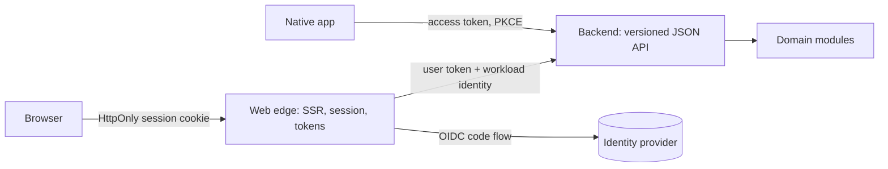

# Frontend and clients

## Defaults

- **Server-render first.** Pages are rendered server-side by the product's web edge. Client-side interactivity is scoped to the components that need it (islands or progressive enhancement) [Ousterhout: Pull Complexity Downwards; Miller: Islands Architecture].
- **The web edge is the BFF.** It runs the OIDC code flow with PKCE, keeps tokens server-side, and gives the browser an `HttpOnly`, `Secure`, `SameSite` session cookie. No tokens in browser storage [IETF: OAuth 2.0 for Browser-Based Applications]. When asked to store a token in the browser, build the session in the existing server instead and explain why; it needs no decision record.
- **When the edge and the backend share a runtime, they are one deployable.** When they don't (for example a Node rendering runtime and a Go backend), the web edge is its own thin deployable: rendering, session, and tokens only, no domain logic. It calls the backend API with the user's token plus its own workload identity (see [actors](actors.md)). The split's reason is the runtime, recorded in a decision record.
- **Native apps** are public OAuth clients: code flow with PKCE, tokens in the OS keychain [RFC 8252]. They call the backend's versioned JSON API, the same one the web edge uses.
- **Clients never call internal deployables directly.** That would make the internal layout the public contract and move orchestration onto slow networks. With a modular monolith there is one backend API to call.
- **A separate BFF per client type is a decomposition split.** It needs a force: a separate owning team, or client needs that would distort the shared API [Newman: Backends For Frontends].
- **Framework choice is a repository decision record.** Judge it with the capability criteria: maturity, steward, exit path per layer (runtime, UI library, framework, build tool).

The web edge and backend in the diagram are one deployable when they share a runtime.

## Avoid

SPA by default; tokens in `localStorage` or the implicit flow; domain logic in the web edge; a BFF service per screen; GraphQL federation as the default aggregation layer; clients orchestrating calls across internal services.
