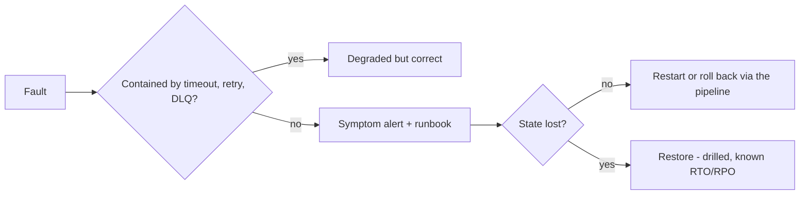

# Operability

Design so a fault in one component does not become a failure of the system [DDIA: Reliable, Scalable, and Maintainable Applications]. Operability and simplicity are the same goal.

## Failure handling

- A timeout on every remote call [Nygard: Timeouts].
- Retry at exactly one layer, with exponential backoff and jitter, only against idempotent targets [Brooker: Exponential Backoff and Jitter]. Retries at several layers multiply into storms.
- Circuit breakers and bulkheads only where measured load warrants [Nygard: Circuit Breaker, Bulkheads].
- Crash on impossible state rather than limping on [Pragmatic: Dead Programs Tell No Lies]. Workloads are disposable: restart is the normal recovery path [Candea: Crash-Only Software].

## Observability baseline

Every component has:
- RED metrics (rate, errors, duration);
- structured logs with trace id, principal, and executor;
- liveness and readiness probes, and graceful shutdown on SIGTERM;
- **Logs:** one JSON event per line to stdout, also carrying service, version (git SHA), and environment [Twelve-Factor: Logs]. ERROR means someone must act, WARN a handled degradation; DEBUG is off in production. Secrets and personal data are never logged; redact in the logger (field allowlist or typed values), not by convention [OWASP Logging Cheat Sheet].
- **Metrics:** OpenTelemetry semantic-convention names where one exists; base units (seconds, bytes), `_total` on counters, histograms for durations. Labels are bounded sets (route template, status class), never ids, emails, or raw paths. A build-info metric carries the version [Prometheus: Naming; OpenTelemetry: Semantic Conventions].
- **Traces:** propagate W3C trace context everywhere, including message headers; a consumer links its span to the producer's. Run a trace backend, and choose sampling (keep errors), only when a real cross-component debugging need appears [W3C Trace Context].

## Alerting

- Alert on symptoms users feel: SLO burn rate, error rate, a down single instance with no failover, dead-letter growth, backup age, and saturation that will cause an outage (disk full) [Google SRE: Monitoring Distributed Systems].
- Staleness: every scheduled job exports its last-success time and alerts when that is older than about twice its interval; every certificate and expiring credential alerts well before expiry (for example 14 days).
- Every alert has a runbook link (`runbook_url`). Causes such as CPU and memory go on dashboards.

## Availability and recovery

- Each stateful capability states its availability target (RTO and RPO) and has a performed restore drill; a backup never restored is a hypothesis. A scheduled job restores the latest backup into a scratch target, checks it, records restore time against the RTO and backup age against the RPO, and alerts on failure or staleness [Google SRE: Data Integrity]. Full-site recovery is drilled manually from a runbook.
- A few critical user journeys run as scheduled synthetic probes against production and feed a symptom alert.
- Scheduled data checks only for stated invariants that span stores or copies (derived data matches its source, the outbox drains), each with an alert.
- Choose the simplest setup that meets the target: a single instance with a drilled restore when that suffices, replicas or HA when it does not [Brooks: The Second-System Effect].
- Size with back-of-the-envelope estimates before choosing infrastructure [Bentley: The Back of the Envelope]; set resource requests from measured usage.

## Avoid

Host checks and threshold alerts on causes; logging on hosts only; HA as a default; runbooks outside the alert.
