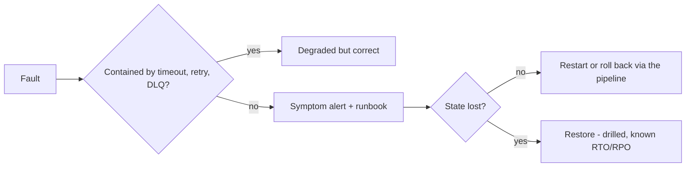

# Operability

Design so a fault in one component does not become a failure of the system [DDIA: Reliable, Scalable, and Maintainable Applications]. Operability and simplicity are the same goal.

## Failure handling

- A timeout on every remote call [Nygard: Timeouts].
- Retry at exactly one layer, with exponential backoff and jitter, only against idempotent targets [Brooker: Exponential Backoff and Jitter]. Retries at several layers multiply into storms.
- Circuit breakers and bulkheads only where measured load warrants [Nygard: Circuit Breaker, Bulkheads].
- Crash on impossible state rather than limping on [Pragmatic: Dead Programs Tell No Lies]. Workloads are disposable: restart is the normal recovery path [Candea: Crash-Only Software].

## Observability baseline

Every component has:
- RED metrics (rate, errors, duration);
- structured logs with trace id, principal, and executor;
- liveness and readiness probes, and graceful shutdown on SIGTERM.

Propagate trace context everywhere; run a trace backend only when a real cross-component debugging need appears.

## Alerting

- Alert on symptoms users feel: SLO burn rate, error rate, a down single instance with no failover, dead-letter growth, backup age, and saturation that will cause an outage (disk full) [Google SRE: Monitoring Distributed Systems].
- Every alert has a runbook link (`runbook_url`). Causes such as CPU and memory go on dashboards.

## Availability and recovery

- Each stateful capability states its availability target (RTO and RPO) and has a performed restore drill; a backup never restored is a hypothesis. simple-testing covers automating the drill.
- Choose the simplest setup that meets the target: a single instance with a drilled restore when that suffices, replicas or HA when it does not [Brooks: The Second-System Effect].
- Size with back-of-the-envelope estimates before choosing infrastructure [Bentley: The Back of the Envelope].

## Avoid

Host checks and threshold alerts on causes; logging on hosts only; HA as a default; runbooks outside the alert.
