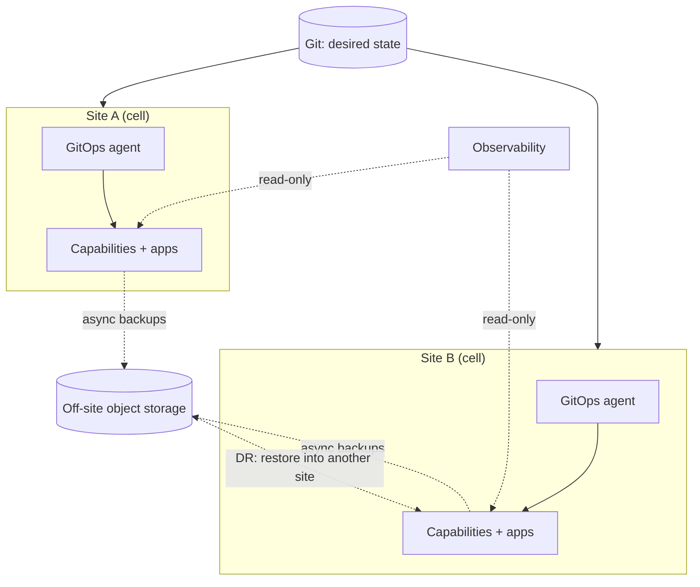

# Multi-site topology

## Defaults

- **Each site is an independent cell.** No runtime dependency crosses a site boundary: no cross-site reads, calls, consumers, or quorums [Helland: Life beyond Distributed Transactions; AWS: Cell-Based Architecture]. A WAN partition then degrades nothing except the cross-site paths below.
- Only three things cross sites:
  - desired state flows in through the deployment pipeline (for example GitOps);
  - backups flow out to object storage outside the site;
  - observability is read across sites, read-only.
- **No stretched clusters** (etcd, database, or broker quorums across a WAN). No synchronous replication across sites. Across distance, every consistency guarantee costs latency on every request [DDIA: Replication; Abadi: PACELC].
- **Disaster recovery across sites:** off-site async backups, restored into another site. The restore is drilled with a stated RTO and RPO (see [operability](operability.md)). A warm replica at another site is added only when restore cannot meet a stated target.
- **Data placement is explicit.** Each dataset has one home site. Personal data stays where residency rules require, and that includes backup locations.

## Avoid

Stretched clusters; active-active by default; cross-site service calls; a broker spanning sites so consumers depend on remote state; KubeFed-style federation control planes.
