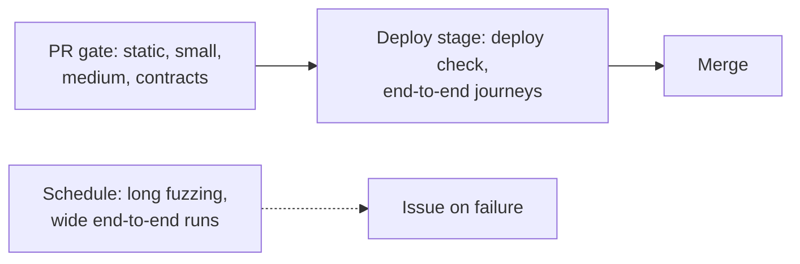

# Coverage and CI

## Coverage

Coverage finds untested code; it does not measure test quality. Low coverage signals a problem, high coverage proves little [Fowler: TestCoverage; Khorikov: Coverage].

- No global threshold or gate [Google: Code Coverage Best Practices].
- In review, read coverage of the changed lines: test what is uncovered or say why not.
- Cover states and behaviors, not lines [Pragmatic: Pragmatic Starter Kit]. Never write a test only to raise the number.

## CI layout

- **PR gate:** static checks, small, medium, and contract checks, each tier its own job, in about 10 minutes [Fowler: Continuous Integration; Humble and Farley: Continuous Delivery].
- **Deploy stage:** deploy to the PR or dev environment; the deploy check and the few end-to-end journeys pass before merge (see deploy).
- **Scheduled:** long fuzz runs, wider end-to-end runs and matrices.
- Fixing a broken default branch comes before other work.
- Test sizes drive timeouts and which job runs a test [SWE at Google: Continuous Integration].
- Add test selection by changed files only when the suite is too large for the gate's time budget.

## Avoid

A coverage percentage as a gate or goal; one serial job running every tier; end-to-end tests only at night; merging over a red default branch.
