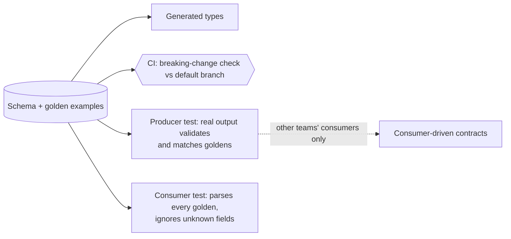

# Contracts between deployables

"Contract test" means two things: a suite that keeps a fake honest against the real implementation (see unit), and checks that a producer and its consumers agree on an API or message format (this file). simple-architecture decides the contract itself: one schema format, generated types, major versions, tolerant readers. This file covers how it is tested.

## Defaults

- The schema in the producer's repository is the source of truth; types are generated from it, never hand-written [Brooks: Passing the Word; Evans: Published Language].
- CI runs a breaking-change check of the schema against the default branch (for example `buf breaking`, `oasdiff`, a JSON Schema diff).
- Golden examples (test vectors) sit next to the schema and are versioned with it. The producer's real output must validate against the schema and match the goldens; every consumer must parse every golden and ignore unknown fields [Fowler: TolerantReader; DDIA: Encoding and Evolution].
- Consumers pull goldens the same way they pull the schema or generated types.
- Additive changes only within a major version. A breaking change is a new major version, with both served while consumers migrate.
- Consumer-driven contracts (Pact-style, with a release gate such as `can-i-deploy`) only when consumers belong to other teams and deploy independently [Fowler: Consumer-Driven Contracts].

## Avoid

Hand-copied types on either side; a contract verified only by a broad end-to-end run; lock-step deploys of producer and consumers; consumer-driven contract tooling for a system one team owns.
