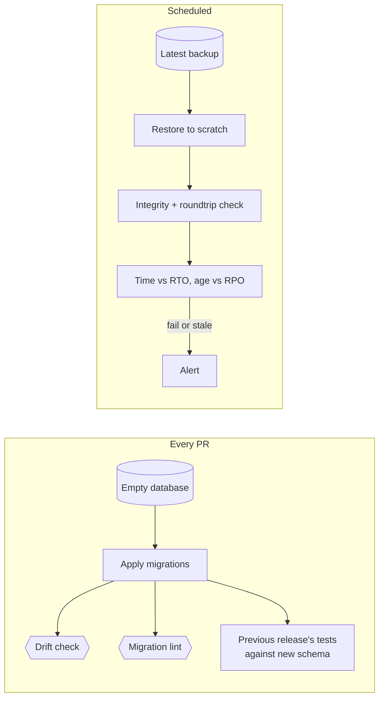

# Data, migrations, restores

simple-architecture requires expand/contract migrations and a drilled restore with stated RTO and RPO. This file covers checking them automatically.

## Migrations

On every PR [Fowler: Evolutionary Database Design; Sadalage and Ambler: Refactoring Databases]:

- Apply all migrations to an empty database; the medium tier already builds its schema this way (see integration).
- Check drift: the committed schema dump or generated code must match what the migrations produce.
- Lint migrations for locking and backward-incompatible DDL (for example Squawk, strong_migrations, Atlas lint).
- On an expand step, run the previous release's medium tests or deploy check against the new schema: old and new code share the data during a rollout [DDIA: Encoding and Evolution].
- Migrations are forward-only; fix a bad one with a new migration. Rehearse on production-sized data only for changes to large tables.

## Restore tests

A backup never restored is a hypothesis [Google SRE: Data Integrity; GitLab: 2017 Outage]. A scheduled job:

1. restores the latest backup into a scratch target;
2. runs integrity checks and the deploy roundtrip check against it;
3. records restore time against the RTO and backup age against the RPO;
4. alerts on failure or staleness.

Full-site and disaster-recovery scenarios are drilled manually from a runbook.

## Production data checks

Add scheduled checks only for stated invariants that span stores or copies: derived data matches its source, the outbox drains, counts reconcile. Each check has an alert [Google SRE: Data Integrity]. Nothing generic.

## Avoid

Down migrations as the rollback plan; hand-edited schema dumps; a backup job's success taken as proof of restore; generic data-quality suites on application databases.
