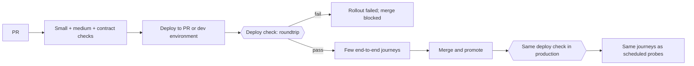

# End-to-end and deploy-time checks

Large tests trade hermeticity for fidelity: keep them few, owned, and debuggable [SWE at Google: Larger Testing]. Verification continues after deploy: a smoke check gates the rollout, and probes catch what pre-production tests miss [Google SRE: Testing for Reliability; Sridharan: Testing in Production].

## Deploy check

Every deployable gets a post-deploy roundtrip check (for example an Argo CD PostSync hook or `helm test`):

- It writes and reads through the real paths (API, store, broker) with test-scoped data, then cleans up.
- A failure fails the sync or rollout and blocks merge or promotion.
- The same check runs in every environment.
- Readiness and liveness probes are not enough: a ready pod with wrong credentials or wiring passes them.
- Canary analysis only when the rollout tool already supports it.

## End-to-end tests

- Only a few critical journeys (sign-in, the core write, the core read), run against the PR or dev deployment.
- Through a browser only when there is a UI; otherwise through the public API.
- Use user-facing locators (role, label, text), auto-waiting assertions, and an isolated browser context per test; record traces on failure. Never sleep. Never test third-party sites.

## Synthetic probes

The same journeys run on a schedule against production and feed a symptom alert. The alert and runbook follow simple-architecture's operability rules.

## Avoid

A large UI regression suite; manual regression cycles; "deployed" treated as done; a health endpoint as the only check; one shared staging environment as the only verification.
