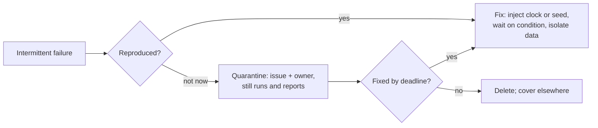

# Test data, determinism, flaky tests

A test that sometimes fails is worse than none: people learn to ignore red [Fowler: Eradicating Non-Determinism]. The usual causes are async waits, concurrency, and order dependence [Luo: Flaky Tests].

## Test data

- Fresh fixture: each test builds its own data; share setup only when it is immutable [Meszaros: Fresh Fixture; Fowler: Building Tests].
- Build data with small builder or factory functions that have valid defaults; the test overrides only what it is about, so the relevant values are visible [GOOS: Test Data Builders].
- Prefer descriptive and repetitive over DRY in tests: no loops or conditionals, one behavior per test, named after that behavior, arrange-act-assert [SWE at Google: Unit Testing].
- No large fixture files for behavior tests: data defined out of sight hides what a test depends on [Meszaros: Test Smells]. Golden examples for contracts are fine (see contracts).

## Determinism

- Inject the clock; never read wall time inline [Khorikov: Working with Time; DDIA: The Trouble with Distributed Systems].
- Inject randomness and print the seed on failure.
- Never sleep. Wait on a condition with a deadline, or use fake time (for example Go `testing/synctest`, fake timers).
- Tests pass in any order and in parallel; turn on random order where the runner supports it.
- Run the race detector where the language has one.
- No real external network in small or medium tests.
- Tests pass in any time zone and locale.

## Flaky tests

- A flaky test is a defect. Reproduce it with repeated runs, random order, the race detector, or the printed seed, then fix the cause.
- If it can't be fixed now, quarantine it: out of the gate, still run and reported, with an issue and an owner. If it is not fixed by the stated deadline, delete it and cover the behavior at another tier.
- CI retries are allowed only if a pass on retry is reported as flaky.
- Never fix a flaky test with sleeps, longer timeouts, or retries.

