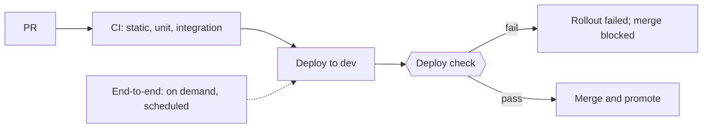

# End-to-end tests and the deploy check

End-to-end tests trade speed and hermeticity for fidelity: keep them few, owned, and debuggable [SWE at Google: Larger Testing].

## End-to-end tests

- Cover only a few critical journeys, such as sign-in, the core write, and the core read.
- Run them on demand against a deployment and on a schedule; a scheduled failure opens an issue.
- Go through a browser only when there is a UI; otherwise through the public API.
- Use user-facing locators (role, label, text), auto-waiting assertions, and an isolated browser context per test; record traces on failure. Never sleep. Never test third-party sites.

## Deploy check

Every deployable gets a post-deploy check that fails the rollout (for example an Argo CD PostSync hook or `helm test`) [Google SRE: Testing for Reliability]:

- It writes and reads through the real paths (API, store, broker) with test-scoped data, then cleans up.
- A failure fails the sync or rollout and blocks merge or promotion.
- The same check runs in every environment.
- Readiness probes are not enough: a ready pod with wrong credentials or wiring passes them.

