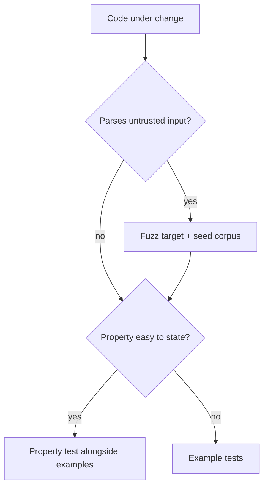

# Property-based tests, fuzzing, mutation testing

These generate cases or faults nobody would write by hand. Example-based tests stay the default.

## Property-based tests

Generate inputs, check a property, shrink a failure to a minimal case [Hughes: QuickCheck; Hypothesis]. Use them when a property is easy to state [Hughes: How to Specify It; Pragmatic: Property-Based Testing]:

- round-trip: `decode(encode(x)) == x`;
- an invariant of a data structure or domain rule [Bentley: Writing Correct Programs];
- agreement with a simple reference model;
- idempotence, or related inputs giving related outputs.

For state machines and concurrency claims, use stateful model-based tests: random operation sequences checked against a model [DDIA: Consistency and Consensus]. Keep each shrunk failure as an example test.

## Fuzzing

Code that parses untrusted or external input gets a coverage-guided fuzz target (for example Go native fuzzing, cargo-fuzz, Atheris) [Go: Fuzzing]:

- a seed corpus checked in next to the test;
- a short, time-boxed run in CI, longer runs on a schedule;
- every failing input kept as a regression case.

## Mutation testing

Inject small faults and check whether the tests catch them; this measures the tests, which coverage cannot [Pragmatic: Pragmatic Starter Kit]. Run it on demand, on the changed lines of critical logic: when tests look weak, or before trusting a suite for a refactor. Review the surviving mutants; never make the score a gate or target [Google: Mutation Testing].

