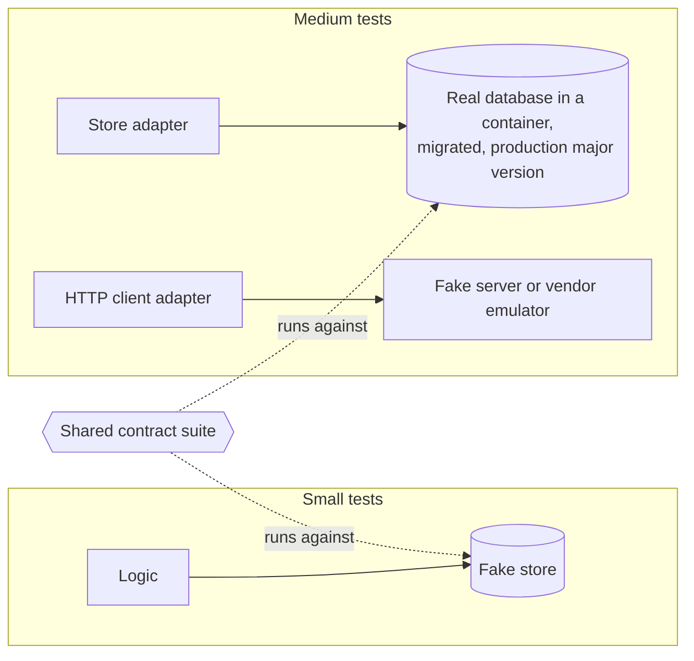

# Integration tests

An integration test checks code against a real out-of-process dependency. Prefer narrow integration tests: one adapter against one real dependency, rather than the whole system with everything live [Fowler: IntegrationTest].

## Dependencies you own

For a database, cache, or broker only your application uses [Khorikov: Database Testing]:

- Use the real thing in a container, with the same engine and major version as production. No in-memory or substitute engines: isolation, locking, and constraint behavior differ between engines and versions [DDIA: Transactions].
- Build the schema with the real migrations.
- The fake from small tests runs the same contract suite as the real adapter (see unit).

## Starting dependencies

- One documented command starts the dependencies and runs the tier, locally and in CI.
- The mechanism is the repository's choice: a compose file when the same file serves local development, test-managed containers (for example testcontainers) when tests need isolation per package. Both work with podman.

## Isolation between tests

- Each test creates its own uniquely keyed data and never relies on rows another test created.
- When a test needs an empty or exclusive database, give it a fresh one cloned from a migrated template database.
- Roll back a transaction per test only where the framework and the application share one connection (Rails, Django). Elsewhere it hides commit-time behavior: deferred constraints, triggers, several connections.

## Third-party services

Test the adapter against a fake server at the HTTP edge (an in-process test server, WireMock, MSW) or the vendor's emulator. Contracts with the real service are covered by contracts and deploy checks.

## Avoid

A shared long-lived test database with order-dependent data; a hand-maintained test schema; tests that call live third-party APIs; every integration test booting the whole system.
