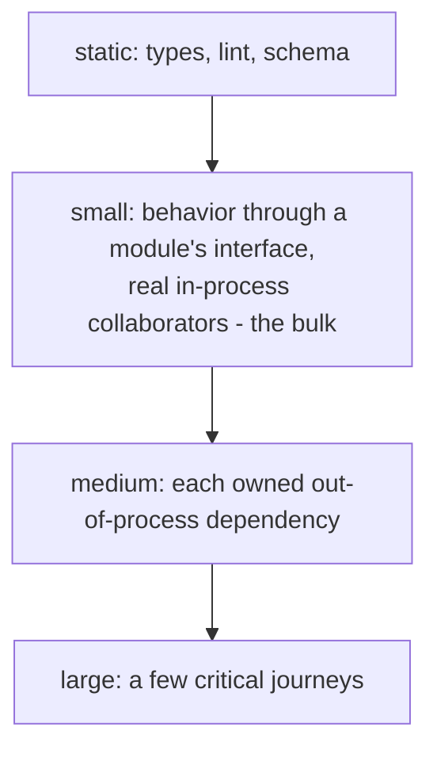

# Shape and sizes

Pyramid, trophy, and honeycomb mostly disagree about what "unit" means: a sociable unit test with real in-process collaborators is what the trophy and honeycomb call integration [Fowler: Shapes of Testing; Fowler: Practical Test Pyramid; Dodds: Testing Trophy; Spotify: Testing Honeycomb]. What all of them share: tests at several granularities, fewer tests the slower they are, behavior over implementation.

## Sizes

Classify a test by what it may touch; scope (how much code it verifies) is a separate axis [SWE at Google: Testing Overview].

| Size | May touch | Typical time | Runs |
| --- | --- | --- | --- |
| small | one process; no I/O, no sleep | milliseconds | every save and every PR |
| medium | one machine: localhost network, real dependencies in containers | seconds | every PR |
| large | a deployed system, a browser, several services | minutes | on the PR deployment, after deploy, on a schedule |

Static checks (types, lint, schema validation) are the base layer: do not write tests for what a checker catches.

## Defaults

- The bulk is small, sociable tests of behavior through a module's interface.
- Every out-of-process dependency the code owns gets a medium test (see integration).
- A few large tests cover critical journeys (see deploy).
- No fixed ratio. The shape follows the system: a library is pyramid-shaped, a service honeycomb-shaped, a UI trophy-shaped.

## Tiers and commands

- Keep the repository's tier names and mechanisms (directories, build tags, test markers).
- The default test command runs only small tests. Each slower tier is opt-in through one documented command that also starts what the tier needs, locally and in CI.

## Avoid

Mostly end-to-end or manual tests (the ice-cream cone); a mock-every-collaborator "unit" layer as the bulk; one test command that mixes all tiers; quotas per tier.
