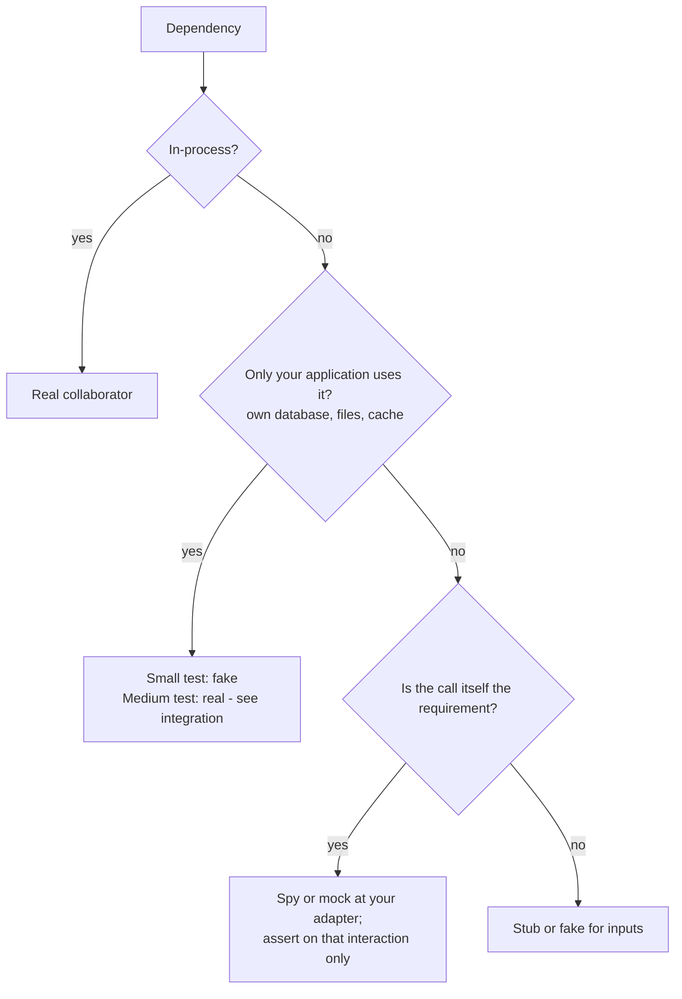

# Unit tests and test doubles

A unit test checks one unit of behavior, quickly, isolated from other tests, not from its collaborators [Khorikov: Observable Behavior]. This is the classical (Detroit) school: real objects, assertions on state and outputs. The mockist (London) school replaces every collaborator and verifies calls, which breaks tests on refactors that keep behavior [Fowler: Mocks Aren't Stubs].

## Test doubles

A test double is anything that stands in for a real dependency in a test [Meszaros: Test Double]. Example: a `SignupService` that saves a user and sends a welcome email.

| Kind | What it is | Example |
| --- | --- | --- |
| dummy | passed to fill a parameter, never used | a nil logger |
| stub | returns canned answers; never asserted on | a user store whose `Exists` always returns false |
| spy | a stub that records calls for later assertions | a mailer that appends sent messages to a list |
| mock | preset with expected calls, fails itself if they don't happen | `mailer.EXPECT().Send(...)` from a mocking library |
| fake | a working, simpler implementation | an in-memory user store backed by a map |

## Rules

- Use real code for everything inside the process. Don't replace an in-process collaborator to isolate a test.
- Use a double only where code leaves the process. Prefer real, then fake, then stub, then mock [SWE at Google: Test Doubles].
- Use a fake for a dependency only your application touches (your database, files, cache) in small tests; the real thing runs in medium tests (see integration).
- Use a spy or mock only when the call itself is the requirement and other systems observe it: an email sent, an event published to other applications, a third-party API called [Khorikov: Unmanaged Dependencies]. Assert on that interaction only.
- Never assert on stubs.
- Mock only types you own: put an adapter around a third-party API and mock the adapter [GOOS: Only Mock Types You Own]. Role interfaces you own at outbound ports may be mocked.
- A hand-written fake lives next to the real implementation or its seam. The fake and the real implementation pass one shared contract test suite, so the fake cannot drift [Fowler: ContractTest].
- Never patch module or import paths (`mock.patch("pkg.mod.fn")`, `jest.mock("./mod")`); inject the dependency instead. Shaping the seam is simple-code's job [Feathers: Seams].
- Never widen visibility for a test. Private code is covered through the public interface.

## Avoid

Tests that mirror the implementation line by line; verifying call order between internal objects; a mock per collaborator; interfaces created only so something can be mocked; tests of private methods.
